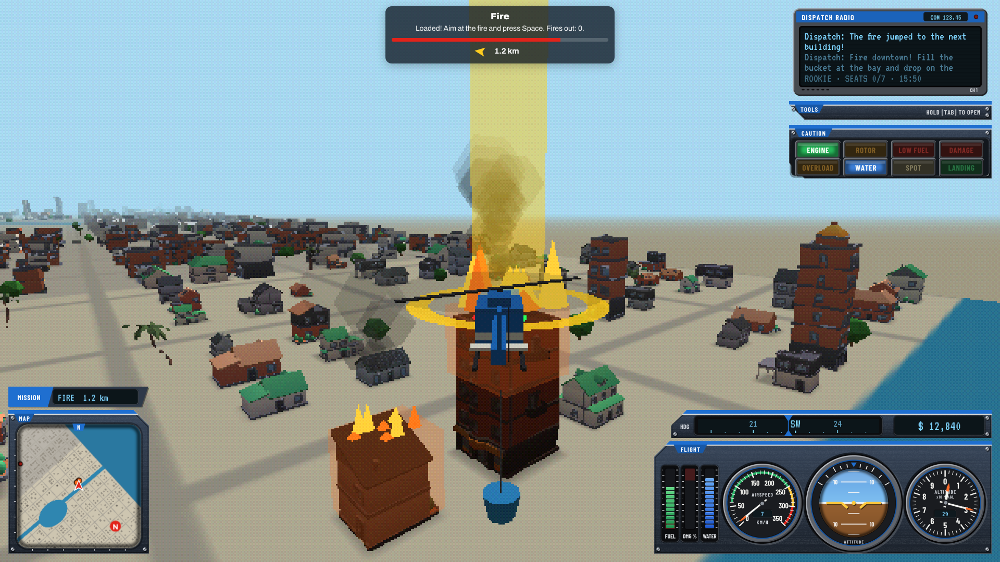

# SOS Copter 🚁

**A low-poly, 90s-style helicopter rescue game that runs in the browser — on PC or phone.**
Jogo de resgate de helicóptero em 3D low-poly, no estilo dos simuladores dos anos 90, que roda direto no navegador.



**▶ Play / Jogar:** https://inhocsignoludimus.github.io/SOS-Copter/ · [itch.io](https://inhocsigno.itch.io/sos-copter)

---

## English

Start as a rookie pilot with a tiny two-seat chopper, take calls from dispatch and build a career flying over the city.

**Missions:** air taxi · firefighting with a slung bucket · medevac · sea rescue with the winch · rooftop rescue · police chases · traffic and riot control · floods. You can also step out of the helicopter and walk around.

**Features**
- **Story mode:** start at level 1 and unlock new cities as you reach each city's goal. Money, helicopters and rank come with you.
- **Free career** in Miami or Recife (Brazil), plus **Free Flight** with everything unlocked
- 9 aircraft in 4 tiers and gear to buy in the hangar
- A 3D city with day/night cycle, weather, traffic and pedestrians
- **PC cockpit:** compact modules in the screen corners (radio, map, flight instruments, caution lights, tools). Hold **Tab** for the tools panel.
- Original elevator-lounge soundtrack, optional PS1 look
- Keyboard, mouse, gamepad and touch · English and Portuguese · works offline (installable as an app)

**Controls (PC):** ↑/↓ climb/descend (↑ starts the engine) · W/S nose down/up · A/D turn · Q/E slide · Space drop water · L spotlight · G loudspeaker · K gas · V ground support · Enter/Backspace accept/decline · E exit/board (landed) · H hangar · I engine · C camera · M sound · Tab tools · P/Esc pause. Full list in **Options → See all controls**.

## Português

Comece como piloto novato num helicóptero de dois lugares, atenda às chamadas da central e construa sua carreira sobrevoando a cidade.

**Missões:** táxi aéreo · incêndios com balde · resgate médico · resgate no mar com guincho · resgate em telhado · perseguição policial · trânsito e tumulto · enchentes. Também dá para descer do helicóptero e andar a pé.

**Destaques:** modo história com níveis e cidades liberadas aos poucos · carreira livre em Miami ou Recife · voo livre · 9 aeronaves · cabine nova no PC (segure **Tab** para as ferramentas) · trilha de música de elevador · visual PS1 opcional · teclado, mouse, controle e toque · inglês e português · funciona offline.

**Comandos:** veja em **Opções → Ver todos os comandos**.

---

## Running locally / Rodando no seu computador

No build step. Serve the folder with any static web server and open `index.html`:

```sh
python3 -m http.server 8000
# abra / open http://localhost:8000
```

Opening `index.html` directly (double click) also works: models, textures and cities are embedded in scripts.

**GitHub Pages:** Settings → Pages → Branch `main` / root → Save. The `.nojekyll` file is already included.

## Project layout / Estrutura

| Path | What it is |
|---|---|
| `index.html` | page, styles, studio intro and HUD markup |
| `js/` | game code: `core.js` (city and map), `scene.js` (3D), `heli.js` (flight), `world.js` (traffic, people, fires), `missions.js`, `ui.js`, `input.js`, `story.js`, `cockpit.js` (PC HUD), `music.js`, `i18n.js` |
| `js/city-*.js` | city packages (Miami, Recife) and `city-sc2.js` (SimCity 2000 city importer) |
| `js/sc2.js` | `.sc2` file reader |
| `js/maps/` | story mode cities (embedded `.sc2` data) |
| `js/hud-pack.js` | PC cockpit sprites, embedded (loaded on PC only) |
| `models/kenney.js` | 3D models packed by `tools/build_models.py` |
| `tools/` | asset tools: model converter, map packer, HUD atlas |
| `lib/`, `fonts/` | three.js r128 and fonts |

**Adding a story city:** `python3 tools/make_map.py city.sc2 my_city "My City" "Author" 2 thumbnail.png`, then add `<script src="js/maps/my_city.js"></script>` to `index.html` before `js/city-sc2.js`.

## Credits / Créditos

**SOS Copter** — an original game by **In Hoc Signo Ludimus**, created by **Rodrigo Torquato Mazzoli**.

- **Story mode cities** (DiabloVille, Sea Cliff, Islandtown, Cypress, Lanville, CatNip Cove, Treeton, Keithly): created by **Darkwolf** for SimCity 2000 — thank you!
- **3D models:** [Kenney](https://kenney.nl) (Car Kit, City Kit Commercial/Suburban/Roads) and [Quaternius](https://quaternius.com) (Ultimate Nature Pack, Animated Human) — CC0
- **Rotor sound:** "Helicopter Sounds" by aquinn, OpenGameArt — CC0
- **PC cockpit art:** Ludimus
- **`.sc2` format:** based on the open spec by the [OpenCity2k](https://github.com/OpenCity2k/SC2k-docs) project (CC BY-SA 4.0)
- **Libraries and fonts:** three.js r128 (MIT) · Archivo, Archivo Black, Press Start 2P, Cinzel, Cormorant Garamond, VT323, Barlow Condensed (SIL OFL)

Inspired by the helicopter sims of the 90s. SimCity 2000 and SimCopter are trademarks of Maxis / Electronic Arts; this is a non-commercial fan study project with no affiliation. See [CREDITS.txt](CREDITS.txt) and [LICENSE](LICENSE).
